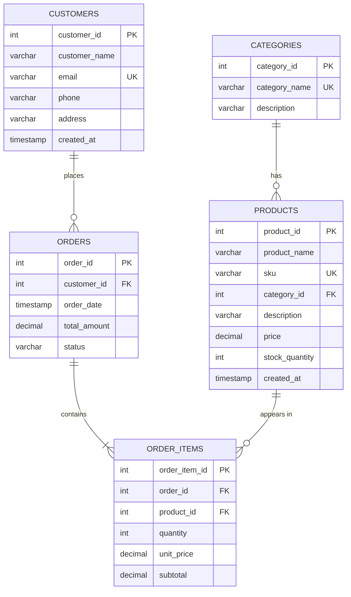

# ER Diagram

Paste the block below into https://mermaid.live to export a PNG for your report/PPT.

**Relationships:** Category 1—M Product · Customer 1—M Order · Order 1—M OrderItem · Product 1—M OrderItem
(Order and Product have a many-to-many relationship, resolved by the `order_items` table.)
